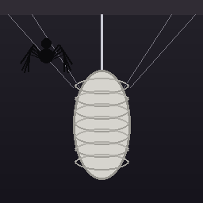

# Hung to Dry

A **Lethal Company** mod (BepInEx) that changes the Bunker Spider: instead of killing you outright it paralyses you, wraps you in silk, drags you back to its lair and hangs you from the ceiling.

[Thunderstore page](https://thunderstore.io/c/lethal-company/p/Militus/Hung_to_Dry/)

Bunker spiders no longer kill outright. They paralyse you, wrap you in silk, drag you to their lair and hang you from the ceiling. Hold a key to cut a teammate down before the timer runs out.

The Bunker Spider's bite no longer kills. Instead, you're paralysed, wrapped in web and carried back to the spider's lair, where you're hung from the ceiling in a cocoon. You watch it all happen from a camera you can turn with the mouse. If nobody frees you before the timer runs out, you die in the cocoon.

**Teammates can save you.** Stand near a hung cocoon and hold the cut-down key until the silk gives way.

## Features

- Paralyse, wrap, drag and hang, using the spider's own animations
- Look around while you're wrapped (mouse to turn, mouse wheel to zoom)
- Teammates cut victims down by holding a key near the cocoon, with a short immunity afterwards
- Everything is synced in multiplayer
- **Chase boost:** the spider speeds up as it closes in, but only while it has a clear line of sight to you, so breaking line of sight slows it down again
- **Web alert:** step in a web and the spider sprints to it. The further away it is, the faster it runs
- **Waiting camouflage:** a spider waiting motionless dissolves into flickering speckles (using the Barber's dissolve effect) and is easy to miss until you get close
- **Hang height:** hung victims are lifted to a set height above the floor, so teammates can always reach them to cut them down
- **More webs:** spiders place more webs, more often, over a wider area
- Anti-stall protection for spiders that get stuck or drop their victim
- Wrapped players are invisible, non-solid and have no name tag, so nobody bumps into a ghost

## Installing

**Every player in the lobby needs the mod, and it must be the same version for everyone.** The spider speed boosts and the web length are worked out on each player's own game or the host, so mismatched versions will look and play differently.

## Settings

The settings file is `BepInEx/config/Militus.HungToDry.cfg`. It appears after the first time you run the game with the mod.

| Setting | Default | What it does |
|---|---|---|
| `SecondsHangingBeforeDeath` | 45 | How long a victim stays hung up before dying |
| `CutDownKey` | E | Hold this near a hung cocoon to cut the victim down |
| `CutDownSeconds` | 4 | How long the key must be held |
| `ImmunitySeconds` | 10 | Time after a rescue when the spider cannot catch the player again |
| `VictimHoldSeconds` | 60 | Safety net: if the spider never hangs the victim, they are released after this long |
| `CarryTimeoutSeconds` | 30 | A spider carrying a victim this long without hanging them hangs them where it is (0 = off) |
| `WallReachMeters` | 0.8 | How close the spider must get to its wall spot before it hangs a victim (the game wants 0.1) |
| `StuckSeconds` | 12 | A spider standing still this long while carrying someone hangs them where it stands |
| `DropHeldItems` | true | Victims drop what they are holding when caught |
| `LookSensitivity` | 0.12 | Mouse speed for the cocoon camera |
| `ChaseBoostEnabled` | true | Spider speeds up as it closes in, only with line of sight |
| `ChaseBoostMaxPercent` | 35 | Extra speed at point-blank range, in percent |
| `ChaseBoostFarMeters` / `ChaseBoostNearMeters` | 20 / 4 | No boost beyond the far distance, full boost inside the near distance |
| `ChaseBoostRampSeconds` | 2 | Seconds to build up to the full boost |
| `WebAlertEnabled` | true | Spider rushes to a web a player has stepped in |
| `WebAlertPercent` | 100 | Base extra speed during the web alert, in percent |
| `WebAlertFarBonusPercent` | 120 | Extra speed added when the spider is far from the web |
| `WebAlertFarMeters` | 20 | Distance at which the far bonus is at its maximum |
| `WebAlertSeconds` | 4 | Longest the web alert lasts (it also ends when the spider arrives) |
| `WaitingFadeEnabled` | true | A waiting spider dissolves out of sight (your screen only) |
| `WaitingDissolve` | true | Use the Barber's dissolve effect, otherwise a smooth fade |
| `WaitingOpacityPercent` | 10 | How much of the waiting spider stays visible |
| `WaitingFadeSeconds` | 2 | How long the dissolve takes |
| `WaitingRevealMeters` | 1 | A player closer than this sees the spider normally |
| `HangHeightAboveGround` | 1.6 | How high above the floor a victim hangs, in metres (0 = the game's own height). Tight spaces use the game's own height |
| `WebCountMultiplier` | 2 | How many webs a spider places (1 = the game's normal 6 to 8) |
| `WebPlaceRateMultiplier` | 2 | How often a patrolling spider places webs |
| `PatrolRadiusMultiplier` | 2 | How far from its start the spider roams while placing webs |
| `EnableDebugSpawnKey` | false | Testing only: host presses the spawn key (default F6) to spawn a spider (F7 logs nearby labels) |

## Emergency release

If anything ever goes wrong, press **F9** to free yourself. This frees you for everyone in the game.

## Reporting bugs

Found a problem? Please [open an issue on GitHub](https://github.com/Militus1/Hung_to_Dry/issues/new/choose) and include your log file.

1. Play until the problem happens, then close the game.
2. In r2modman go to **Settings, then Browse profile folder**, and open `BepInEx/LogOutput.log`.
3. Drag that file into the issue, or paste it at [mclo.gs](https://mclo.gs) and share the link. Do not paste it into chat.

The log contains your player name and some file paths, but no passwords. Say which mod version you have and whether you were the host or a client, because the host's game decides how the spider behaves.

## Known quirks

- Mods that make you untargetable (for example debug tools) will stop the spider catching you, as you'd expect.
- If your game log shows "Tried to wrap body but it could not be found", that is the game's own message and is harmless.

## Credits

Made by Militus.

## Building from source

1. Install the .NET SDK.
2. Open `SpiderCocoon.csproj` and set `GameDir` (your Lethal Company folder) and `BepInExCore` (your mod profile's `BepInEx\core` folder).
3. Run `dotnet build`. The result is `bin/Debug/netstandard2.1/HungToDry.dll`; put it in your profile's `BepInEx/plugins` folder.

All the code is in `Plugin.cs`.

## Licence

MIT. See [LICENSE](LICENSE).
